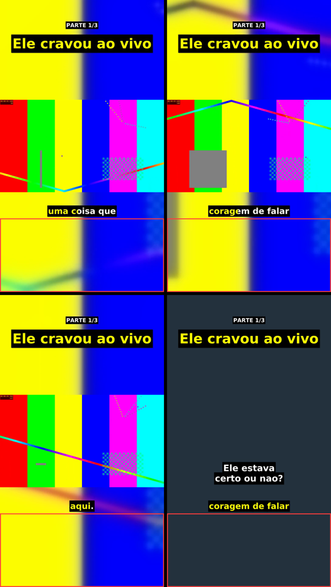
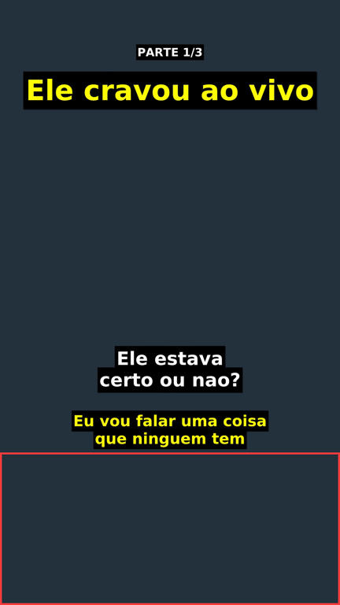

# Cortes de futebol: Drive para YouTube

Arquivo: `workflows/cortes-futebol-youtube.json`

Variação do fluxo de documentário para podcast e mesa de debate de futebol. Mesma espinha (Drive, corte de silêncio, Whisper, agente, ffmpeg, upload espaçado), com três diferenças: legenda de fala em karaokê, tradução automática de áudio em outro idioma e um agente com regras próprias do nicho. A categoria do YouTube é 17 (Esportes).

Os dois fluxos podem rodar ao mesmo tempo desde que cada um monitore uma pasta diferente do Drive. O nó `Drive: novo vídeo` vem com o placeholder `TROCAR_PELO_ID_DA_PASTA_DE_FUTEBOL`.

## Caminho da transcrição

```
Whisper: transcrever                 (granularidade de segmento e de palavra)
  -> Montar transcrição c/ timestamps (segmentos, palavras e idioma detectado)
  -> Idioma é português?
       sim -> Transcrição pronta
       não -> GPT: traduzir segmentos -> Aplicar tradução -> Transcrição pronta
  -> AI Agent
```

`Transcrição pronta` é o ponto único de convergência: os nós seguintes não precisam saber se houve tradução.

## Onde entra IA

| Etapa | Modelo | Papel |
|---|---|---|
| Transcrição | `whisper-1` | segmentos e palavras com timestamps, idioma |
| Tradução | `gpt-4.1-mini`, temperatura 0.2, saída JSON | traduz o texto de cada segmento para português |
| Seleção de cortes | `gpt-4o` (AI Agent) | trechos, hook, título, pergunta final, descrição |

### Tradução sem perder sincronia

O modelo recebe os segmentos numerados e devolve os mesmos índices com o texto traduzido. Os tempos vêm do Whisper e não são alterados. O nó `Aplicar tradução` valida a resposta:

| Situação | Comportamento |
|---|---|
| tradução completa | aplica |
| até 20% dos segmentos sem tradução | mantém o original nesses segmentos |
| mais de 20% faltando | falha a execução |
| resposta não é JSON | falha com o trecho da resposta na mensagem |

O endpoint `audio/translations` da OpenAI só traduz para inglês, por isso a tradução é feita sobre a transcrição.

### Regras do agente

- Nunca cortar um assunto pela metade. Em debate, o corte inclui pergunta e resposta e, havendo discordância, os dois lados.
- Prioridade: opinião forte, discordância ao vivo, previsão, bastidor, número que choca. Descarta patrocínio, abertura, papo fora de futebol e despedida.
- Hook e título com nome próprio (time, jogador ou comentarista).
- Atribuição obrigatória: a opinião é de quem falou, nunca afirmada como voz do canal ("Ele disse que o time não joga nada", e não "O time não joga nada").

O alinhamento de início e fim à pontuação da fala é o mesmo do fluxo de documentário.

## Legenda de fala

| Áudio | Modo | Fonte | Cor |
|---|---|---|---|
| português, com timestamps por palavra | karaokê palavra por palavra | 64 | branco para amarelo conforme a fala |
| traduzido, ou sem timestamps por palavra | legenda por segmento | 56 | branco |

Áudio traduzido não usa karaokê: a tradução muda quantidade e ordem das palavras e não existe mapeamento honesto de tempo de uma para outra.

O karaokê usa a tag `\kf` do ASS, que varre a cor ao longo da palavra. Regras de agrupamento:

| Regra | Valor |
|---|---|
| máximo de palavras por linha | 3 |
| máximo de caracteres | 17 (uma linha em 1080 px com fonte 64) |
| pausa que força quebra | 0,6 s |
| ponto final | sempre quebra |

O fim de cada linha é cortado antes do início da seguinte, para evitar duas legendas empilhadas na mesma posição.

Se o Whisper não devolver `words`, o fluxo registra o aviso e cai para legenda por segmento, sem interromper.





## Layout

```
 +--------------------------+  <- 130 px: interface do TikTok (topo)
 |       PARTE 1/5          |  145 px do topo
 |   NOME DETONOU O TIME    |  hook amarelo, fonte 104, fixo
 |                          |
 |         [vídeo]          |
 |                          |
 |   Ele estava certo?      |  680 px do rodapé, últimos 6 s
 |   legenda de fala        |  500 px do rodapé
 +--------------------------+  <- 484 px: interface do TikTok (rodapé)
```

O texto do meio vem desligado (`MOSTRAR_TEXTO_MEIO = false`) para não disputar espaço com a legenda de fala.

## Constantes no nó `Montar cortes + comando de edição`

```js
const LEGENDA_FALA = true;
const KARAOKE_MAX_PALAVRAS = 3;
const KARAOKE_MAX_CHARS = 17;     // acompanha a fonte: caracteres ~ 1100 / fonte
const KARAOKE_PAUSA_QUEBRA = 0.6;
const LEGENDA_MAX_CHARS_SEG = 42;
const MOSTRAR_TEXTO_MEIO = false;
const FONT_FALA = 64;
const FONT_FALA_SEG = 56;
const BAIXO_FALA = 500;           // abaixo de 484 px cai na interface do TikTok
const BAIXO_PERGUNTA = 680;
```

## Antes de ativar

- `EXECUTIONS_TIMEOUT`: podcast de 1 a 2 horas, com corte de silêncio, transcrição, 5 cortes e 4 esperas de 5 minutos, passa de uma hora. Use 7200 ou mais.
- Primeira execução manual: confira se `palavras` veio preenchido, se o corte de silêncio ficou entre 10 e 20% e se os cortes começam no início de um assunto.

## Pendências

- O crédito de licença Creative Commons gerado pelo caçador de pautas não chega a este fluxo; precisa ser incluído manualmente na descrição.
- Não testado com a API real: os dois parâmetros `timestamp_granularities[]` (segment e word) chegando juntos no corpo multipart.
