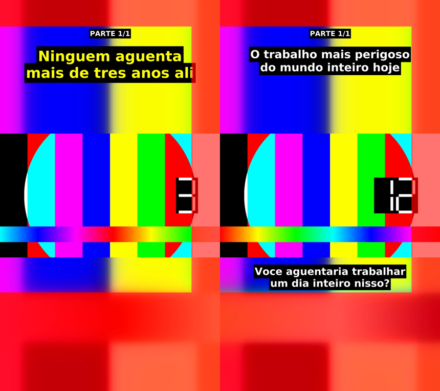

# Tipografia e layout dos cortes

Decisões de texto na tela dos fluxos de cortes e como alterá-las. Os valores de referência estão nas constantes do nó `Montar cortes + comando de edição`; o código é a fonte da verdade.

## Base das decisões

Não há estudo público que meça retenção ou conversão por tipo de fonte em vídeo curto; o que circula sobre isso são blogs de ferramentas de legenda sem fonte verificável. O que tem base é legibilidade, vinda de guias de legendagem de broadcast (BBC, Netflix) e de acessibilidade (WCAG):

- **Sans-serif.** Serifas se perdem em tela pequena e em compressão.
- **Contraste.** Texto branco ou amarelo sobre caixa preta semitransparente mantém contraste em qualquer fundo. Contorno grosso também funciona; só sombra fica abaixo de AA em fundos claros.
- **Peso.** Bold. Com fontes já pesadas (Anton, Montserrat ExtraBold), deixe `Bold = 0` no estilo ASS, senão o libass engrossa por cima e o texto borra.
- **Menos caracteres, não fonte maior.** Hook curto lê mais rápido que hook longo em duas linhas; o limite é controlado no prompt do agente.

## Zona segura

Em 1080x1920 no TikTok, a interface cobre aproximadamente:

| Região | Altura/largura |
|---|---|
| topo (abas, busca) | 130 px |
| rodapé (legenda, áudio, perfil) | 484 px |
| direita (botões) | 140 px |

Os textos inferiores ficam a 500 px do rodapé ou mais, com margem lateral de 145 px. As faixas vermelhas abaixo marcam as áreas cobertas pela interface:



## Valores atuais (fluxo de documentário)

| Texto | Fonte (px) | Posição |
|---|---|---|
| selo `PARTE N/T` | 42 | topo |
| hook | 104 | topo, fixo do início ao fim (`TEXTO_TOPO_FIXO = true`) |
| texto do meio | 72 | 500 px do rodapé |
| pergunta final | 68 | 500 px do rodapé, últimos 6 s |

O título do agente não aparece na tela; é usado só como título do vídeo no YouTube.

## Trocar a fonte

1. Coloque o `.ttf` em `/opt/fonts` (a pasta é passada ao libass via `fontsdir`).
2. Descubra o nome da família, que é o que o ASS usa, e não o nome do arquivo:

   ```sh
   fc-query -f '%{family} | %{style}\n' /opt/fonts/Montserrat-ExtraBold.ttf
   # Montserrat ExtraBold | Regular
   ```

3. No nó de código, troque `const FONTE_NOME = 'DejaVu Sans';` pelo valor antes do `|`.

Para fontes diferentes por texto, crie constantes (`FONTE_HOOK`, `FONTE_TITULO`, `FONTE_APOIO`) e use-as nas linhas `Style:` correspondentes.

Para conferir, procure no `stderr` do nó `ffmpeg: editar corte` a linha `fontselect: (Anton, ...) -> Anton-Regular`. Se o lado direito mostrar outra fonte, o nome da família está errado.

Sugestões por função: Anton ou Bebas Neue para hook (condensadas, cabem mais caracteres), Montserrat ExtraBold para o resto. Com uma fonte só, Montserrat ExtraBold.

## Outros ajustes visuais

| Constante | Efeito |
|---|---|
| `CAIXA` | opacidade da caixa atrás do texto em hexa: `00` sólida, `B4` padrão, `FF` sem caixa |
| `Outline` no estilo ASS | espessura do contorno; sem caixa, use 8 a 10 |
| `COR_HOOK` | cor em formato ASS `&HAABBGGRR` (ordem BGR): amarelo `&H0000FFFF`, ciano `&H00FFFF00` |

## Limite de cortes

O teto é 5 cortes por vídeo de origem: cabe na cota diária de upload do YouTube (5 x 1.600 = 8.000 de 10.000 unidades) e mantém o volume diário de publicação controlado.
